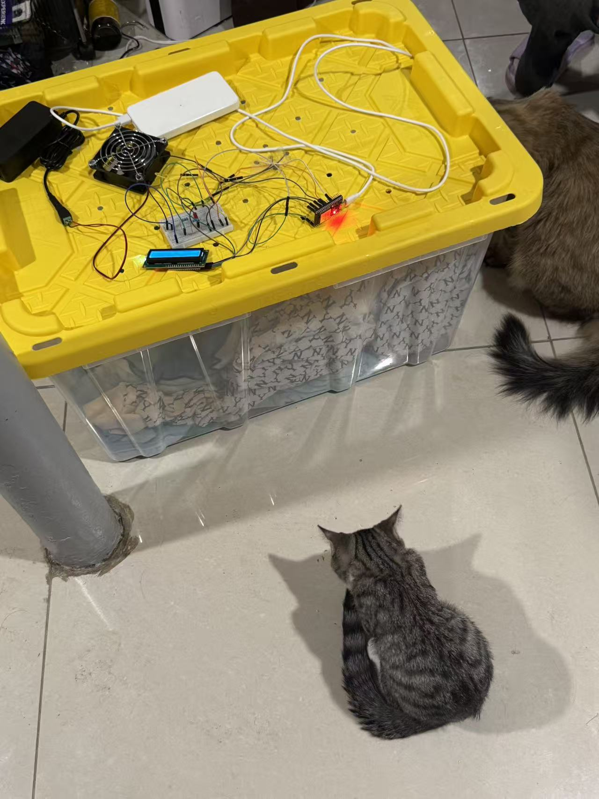
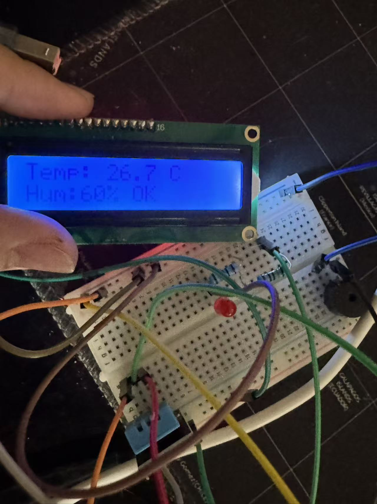
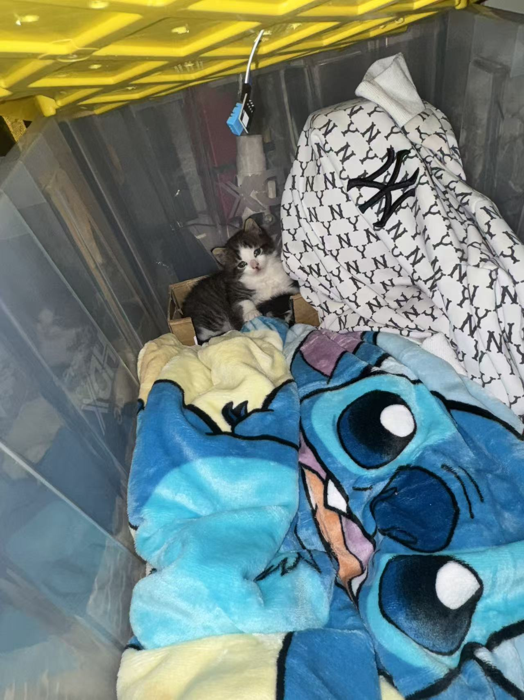
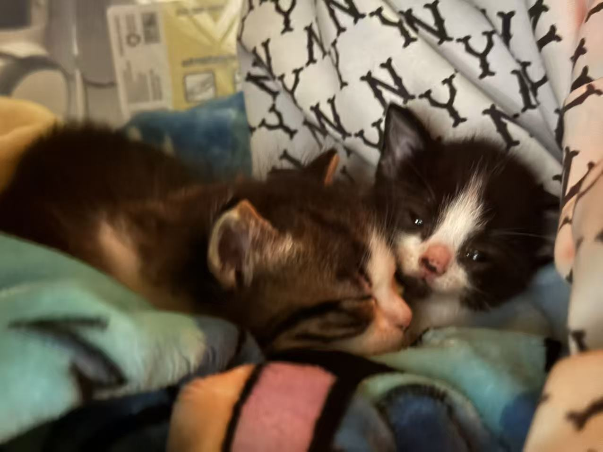

# Kitten Temperature Monitor

**English** | [简体中文](README.zh-CN.md)

An ESP32 prototype for monitoring the air temperature and humidity around a kitten's resting area. A two-line LCD shows the readings, while an LED and buzzer provide feedback when the temperature moves outside the configured range.

[Open the Arduino sketch](firmware/KittenMonitor/KittenMonitor.ino) · [Project photos](assets/)

*The assembled prototype and its monitoring electronics.*

## What it does

- Reads temperature and humidity from a DHT11 sensor.
- Displays temperature, humidity, and `COLD`, `HOT`, or `OK` on an I²C LCD1602.
- Uses an 800 Hz, slower alert for low temperature and a 1500 Hz, faster alert for high temperature.
- Prints readings and status to the Serial Monitor at 115200 baud.
- Shows `DHT11 ERROR` and `Check wiring` when a sensor read fails.

The display is an **LCD1602 with a PCF8574 I²C backpack**, rather than an OLED. Humidity is displayed but does not trigger an alarm.

## Display and sensor placement

*LCD close-up showing air temperature, relative humidity and the displayed status.*

*The DHT11 positioned inside the resting enclosure, above the bedding.*

## Hardware and signal pins

| Component | ESP32 signal pin |
| --- | --- |
| DHT11 data | GPIO4 |
| LED, through a current-limiting resistor | GPIO18 |
| Buzzer | GPIO19 |
| LCD SDA | GPIO21 |
| LCD SCL | GPIO22 |

The components share a common ground. Check power and I²C voltage compatibility against the actual modules; the pin table describes the saved program's signal assignments.

## Open and run

1. Install the **esp32** board package by **Espressif Systems** in Arduino IDE.
2. Install **DHT sensor library** by **Adafruit**, its **Adafruit Unified Sensor** dependency, and **hd44780** by **Bill Perry** through Library Manager.
3. Open [`firmware/KittenMonitor/KittenMonitor.ino`](firmware/KittenMonitor/KittenMonitor.ino).
4. Choose the matching ESP32 board and port, upload, and open Serial Monitor at **115200 baud**.

The sketch uses `hd44780_I2Cexp` to identify the LCD's I²C address and backpack configuration. Exact dependency versions were not recorded with the original sketch.

## Saved configuration and current scope

The preserved sketch sets `MIN_TEMP = 27.0` and `MAX_TEMP = 31.0`. It alerts below 27°C or above 31°C; the boundary values themselves remain in the `OK` state. These are historical project settings, not a universal recommended temperature range for kittens.

The display photograph shows `26.7°C`, `60%` and `OK`. The preserved sketch would show `COLD` below 27°C, so the photo and saved source reflect different threshold settings. The saved source has not been changed to match the photograph.

This program monitors **air temperature**, not body temperature, and does not control a heater or fan. On a DHT read failure, it displays an error and turns off the LED and buzzer. It uses blocking delays and has no data logging, network connection, or independent protective control.

## Development record

I developed this prototype with ChatGPT's help generating the sketch and explaining the connections and behavior. The work began in September 2026. This repository preserves the version recovered from a local Arduino compilation cache dated September 7, 2026; the program logic and its saved thresholds have been kept unchanged.

Publishing this recovered source does not establish a new compilation or hardware test.

## The resting area

*The kittens resting in the area whose surrounding air the prototype was built to monitor.*

The photos show the physical prototype and its context. The complete image files are in [`assets/`](assets/).
